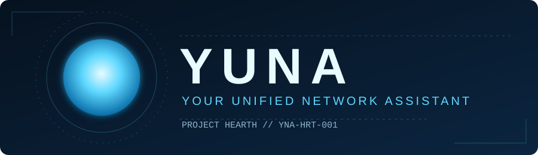
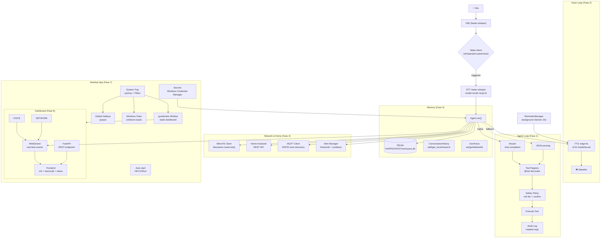

# YUNA — Your Unified Network Assistant



**Project Hearth · YNA-HRT-001**

> *AI pendamping rumah yang terasa hidup: responsif, punya memori, proaktif, dan jujur bahwa dia AI.*

[](https://python.org)
[](https://microsoft.com/windows)
[](https://github.com/AkihikoIzuru/Yuna)
[](LICENSE)

[📖 Story](STORY.md) · [🤝 Contributing](CONTRIBUTING.md) · [📄 License](LICENSE)

---

## 📋 Tentang

**Yuna** (Your Unified Network Assistant) adalah asisten AI rumah yang berjalan di Windows. Dia bisa:
- **Ngobrol pakai teks & suara** (Bahasa Indonesia, persona lembut & tulus ala Yui SAO)
- **Mengingat fakta & percakapan** (SQLite persistent)
- **Reminder/alarm** yang bunyi lewat TTS, persisten setelah restart
- **Monitor & kontrol jaringan** (MikroTik read-only, Home Assistant)
- **Dashboard real-time** (FastAPI + WebSocket, buka di HP juga)
- **Desktop app + System tray** (single instance, hotkey global, auto-start, notifikasi Windows)

Yuna *terasa* hidup karena: persona orisinal, memori jangka panjang, sapaan proaktif (jam tenang/cooldown), avatar orb ekspresif, dan gaya bicara yang bervariasi — tapi tetap **jujur bahwa dia AI**, bukan pengganti manusia.

---

## 🖥 Status Window

```text
╔══════════════════════════════════════════════════════════╗
║  YUNA — Your Unified Network Assistant                   ║
║  Project Hearth (YNA-HRT-001)                            ║
╠══════════════════════════════════════════════════════════╣
║  Brain:     9router (OpenAI-compatible)                  ║
║  Model:     yuna (fallback: yuna)                        ║
║  Persona:   yuna (Yui SAO style)                         ║
║  Mode:      Text / Voice (Wake word: "hey yuna")         ║
║  Memory:    SQLite (%APPDATA%\Yuna\yuna.db)              ║
║  Network:   MikroTik RB951Ui-2HnD (read-only, API 8728)  ║
║  Home:      Home Assistant REST + MQTT (ESP32)           ║
║  Fase:      9 (Terasa Hidup) 🔧                          ║
╚══════════════════════════════════════════════════════════╝
```

---

## 🌳 Skill Tree

| Fase | Nama | Status | Deskripsi |
|------|------|--------|-----------|
| 0 | Rename Jarvis → Yuna | ✅ | Paket `yuna/`, env `YUNA_*`, identitas dari config |
| 0B | Cleanup proyek | ✅ | Hapus file lama, pre-commit hook, satu README |
| D | Dokumentasi & GitHub | ✅ | README, LICENSE, CONTRIBUTING, STORY, push |
| 1 | Otak + Tool (teks) | ✅ | REPL, 8 tools dasar, fallback JSON, retry model |
| 2 | Suara (Wake word utama) | ✅ | faster-whisper STT, edge-tts TTS, multi-backend wake |
| 3 | Memori & Personalisasi | ✅ | SQLite, fakta user, reminder TTS, 8 memory tools |
| 4 | Jaringan & Rumah | ✅ | MikroTik read-only, Home Assistant, MQTT, alert |
| 5 | Keamanan & Konfirmasi | ✅ | Risk tier, konfirmasi eksplisit, audit log, allowlist |
| 6 | Dashboard (Web UI) | ✅ | FastAPI + WS, orb visualizer, transcript real-time |
| 7 | Desktop App + Tray | ✅ | pywebview, pystray, single instance, hotkey, notif |
| 8 | Polishing | ✅ | Health check, logging rotation, PyInstaller packaging |
| 9 | Terasa Hidup | 🔧 | Streaming LLM+TTS, proaktif, avatar ekspresif, vision |
| 10 | Yuna Hidup di PC | 🔜 | Sandbox coding, jurnal, path-jail, otonomi terbatas |

> ✅ = jalan & teruji · 🔧 = dikerjakan · 🔜 = rencana

---

## 🏗 Arsitektur



### Pohon Folder

```
yuna/
├── .env.example
├── .gitignore
├── .githooks/pre-commit
├── requirements.txt
├── requirements-voice.txt
├── requirements-wake-oww.txt
├── README.md
├── STORY.md
├── CONTRIBUTING.md
├── LICENSE
├── assets/banner.svg
├── yuna/
│   ├── main.py
│   ├── config.py
│   ├── brain/ (client.py, agent.py, prompts.py)
│   ├── tools/ (registry.py, system.py, home.py, memory.py)
│   ├── voice/ (stt.py, tts.py, wake.py, loop.py)
│   ├── memory/ (db.py, conversation.py, facts.py, reminders.py)
│   ├── safety/ (policy.py)
│   ├── home/ (ha.py, mqtt.py, mikrotik.py, alerts.py)
│   ├── ui/ (server.py, static/index.html)
│   └── app/ (__main__.py, tray.py, window.py, lifecycle.py,
│              autostart.py, hotkeys.py, notify.py, secrets.py, icons.py)
├── packaging/ (yuna.spec, build.ps1)
└── tests/ (test_*.py)
```

---

## ⚡ Instalasi Cepat

### Prasyarat
- Windows 10/11, Python 3.11+
- 9router running di `http://localhost:20128/v1`
- (Opsional) MikroTik RouterOS 7.x dengan user `yuna-ro` (read,api)
- (Opsional) Home Assistant dengan Long-Lived Token

### Setup

```bash
# 1. Clone repo
git clone https://github.com/AkihikoIzuru/Yuna.git
cd Yuna

# 2. Virtual environment (disarankan)
python -m venv .venv
.venv\Scripts\activate

# 3. Upgrade pip & install deps
pip install -U pip
pip install -r requirements.txt           # Fase 1,3,4,5,6
pip install -r requirements-voice.txt     # Fase 2 (voice)
pip install -r requirements-wake-oww.txt  # Opsional: openwakeword backend

# 4. Konfigurasi
cp .env.example .env
# Edit .env (minimal: YUNA_BASE_URL, YUNA_MODEL, YUNA_FAST_MODEL, ROUTER_API_KEY)

# 5. Jalankan 9router (di terminal terpisah)
# Pastikan model 'yuna' tersedia: curl http://localhost:20128/v1/models

# 6. Aktifkan git hook (satu kali per clone)
git config core.hooksPath .githooks

# 7. Tes mode teks
python -m yuna.main --text
```

---

## ⚙️ Konfigurasi

| Variabel | Default | Deskripsi |
|----------|---------|-----------|
| `YUNA_BASE_URL` | `http://localhost:20128/v1` | 9router endpoint |
| `YUNA_MODEL` | `yuna` | Model utama (reasoning) |
| `YUNA_FAST_MODEL` | `yuna` | Model cepat (perintah simpel) |
| `ROUTER_API_KEY` | **required** | API key 9router |
| `ASSISTANT_NAME` | `Yuna` | Nama asisten (persona, banner, tray) |
| `ASSISTANT_FULLNAME` | `Your Unified Network Assistant` | Nama panjang |
| `PROJECT_CODENAME` | `Project Hearth` | Codename proyek |
| `ASSISTANT_ID` | `YNA-HRT-001` | ID unik |
| `USER_NICKNAME` | `Kak Akii` | Panggilan ke user |
| `PERSONA` | `yuna` | `yuna` / `netral` |
| `WHISPER_MODEL` | `small` | Model STT (tiny/base/small/medium) |
| `TTS_VOICE` | `id-ID-GadisNeural` | Voice edge-tts |
| `TTS_RATE` | `+3%` | Kecepatan bicara |
| `TTS_PITCH` | `+3Hz` | Pitch suara |
| `WAKE_BACKEND` | `auto` | `auto\|whisper\|porcupine\|openwakeword` |
| `WAKE_PHRASES` | `yuna,yu na,yuuna,juna,yona,una` | Varian wake word |
| `YUNA_HA_URL` | - | Home Assistant URL |
| `YUNA_HA_TOKEN` | - | HA Long-Lived Token |
| `YUNA_MIKROTIK_HOST` | - | MikroTik IP (kosong = mode simulasi) |
| `YUNA_MIKROTIK_USER` | `yuna` | User MikroTik (grup `yuna-ro`) |
| `YUNA_MIKROTIK_PASSWORD` | - | Password (simpan di Credential Manager) |
| `DATA_DIR` | `%APPDATA%\Yuna` | Folder data SQLite, log, model |
| `LOG_DIR` | `%APPDATA%\Yuna\logs` | Folder log rotasi |
| `UI_HOST` | `127.0.0.1` | Bind dashboard (LAN = 0.0.0.0 + token) |
| `UI_PORT` | `8080` | Port dashboard |

> **Secret** (API key, password router) sebaiknya disimpan di **Windows Credential Manager** via UI Settings, bukan di `.env`.

---

## 🔧 Setup MikroTik (Manual, Read-Only)

> **Claude Code TIDAK menjalankan ini otomatis.** Jalankan manual via Winbox/Terminal.

```routeros
# 1. Backup dulu
/system backup save name=sebelum-yuna
/export file=sebelum-yuna

# 2. Grup minimal: baca + API
/user group add name=yuna-ro policy=read,api

# 3. User khusus, hanya login dari IP PC
/user add name=yuna group=yuna-ro password=PASSWORD_KUAT address=10.x.x.PC/32

# 4. API hanya dari IP PC
/ip service set api address=10.x.x.PC/32
```

**Catatan:** Jika terkunci karena salah batasi IP, Winbox lewat MAC address masih bisa masuk (selama MAC server aktif di interface LAN). API (8728) **tidak boleh** terbuka ke WAN.

---

## 🔐 Keamanan & Privasi

- **Tier risiko tool**: `low` (langsung), `medium` (konfirmasi "ya"), `high` (konfirmasi "ya, lanjutkan")
- **Path-jail**: Semua operasi file/shell terbatas di `%APPDATA%\Yuna\home\` (Fase 10)
- **Audit log**: Semua pemanggilan tool ke `%APPDATA%\Yuna\logs\audit.log` (argumen sensitif di-mask)
- **Prompt injection protection**: Hasil web/file/router dibungkus `[DATA]`, deteksi pattern injeksi
- **Server bind**: Default `127.0.0.1`; akses LAN opsional + wajib token
- **Secret**: Windows Credential Manager (keyring), tidak plaintext, tidak di log
- **TTS**: edge-tts mengirim teks jawaban ke Microsoft. Opsi offline: **Piper TTS** (Fase 8 opsional).

---

## ➕ Cara Menambah Tool Baru

1. Buat fungsi di `yuna/tools/` (contoh: `yuna/tools/web.py`):

```python
from yuna.tools.registry import tool

@tool(risk="low")
def search_web(query: str, max_results: int = 5) -> str:
    """Cari web via search engine."""
    # implementasi...
    return "hasil pencarian"
```

2. Import di `yuna/main.py` (auto-register):

```python
from yuna.tools import system, memory, home, web  # baru
```

3. Tool otomatis muncul di LLM! JSON schema dibangun otomatis dari type hints.

### Type Hints → JSON Schema

| Hint | Schema |
|------|--------|
| `str` | `{"type": "string"}` |
| `int` | `{"type": "integer"}` |
| `float` | `{"type": "number"}` |
| `bool` | `{"type": "boolean"}` |
| `list[str]` | `{"type": "array", "items": {"type": "string"}}` |
| `Optional[int]` / `int = 5` | optional dengan default |
| `int` (tanpa default) | required |

---

## 🛠 Troubleshooting

| Masalah | Solusi |
|---------|--------|
| **Mic tidak kedeteksi** | `python -m yuna.main --list-audio-devices`, pilih index di `.env` |
| **WebView2 tidak ada** | Install [WebView2 Evergreen](https://developer.microsoft.com/en-us/microsoft-edge/webview2/) |
| **Antivirus flag .exe** | False positive PyInstaller → whitelist folder `dist/Yuna/` |
| **9router mati** | Cek `curl http://localhost:20128/v1/models`, pastikan model `yuna` ada |
| **scipy/openwakeword error** | Skip `requirements-wake-oww.txt`; wake word `whisper` backend sudah jalan |
| **webrtcvad build error** | Sudah pakai `webrtcvad-wheels` (prebuilt). Kalau error, hapus dari requirements. |

---

## 🗺 Roadmap

- [x] Fase 0: Rename Jarvis → Yuna
- [x] Fase 0B: Cleanup + pre-commit hook
- [x] Fase D: Dokumentasi (README, LICENSE, CONTRIBUTING, STORY)
- [x] Fase 1: Otak + Tool (teks) — perbaikan registry, EOFError, persona
- [x] Fase 2: Suara (wake word utama, STT+TTS streaming, barge-in)
- [x] Fase 3: Memori & Personalisasi
- [x] Fase 4: Jaringan MikroTik (read-only) + Home Assistant
- [x] Fase 5: Keamanan & Konfirmasi
- [x] Fase 6: Dashboard Web UI
- [x] Fase 7: Desktop App + System Tray
- [x] Fase 8: Polishing (health check, logging, PyInstaller packaging)
- [ ] Fase 9: Terasa Hidup (streaming, proaktif, avatar ekspresif, vision)
- [ ] Fase 10: Yuna Hidup di PC (sandbox coding, jurnal, otonomi terbatas)

---

## 🤝 Kontribusi & Lisensi

- **Lisensi**: [MIT](LICENSE) © 2026 AkihikoIzuru
- **Kontribusi**: Lihat [CONTRIBUTING.md](CONTRIBUTING.md)
  - Satu PR = satu fase/issue
  - Fitur besar buka Issue dulu
  - **Persona orisinal** (no voice cloning, no copyrighted assets)
  - Secret di Credential Manager, bukan kode/log
  - MikroTik read-only sampai Fase 5 selesai
- **Security**: Jangan buka Issue publik untuk celah keamanan. Hubungi `@AkihikoIzuru` lewat profil GitHub.

---

*Dibangun dengan ❤️ oleh Akii & Claude Code — Project Hearth 🌙*